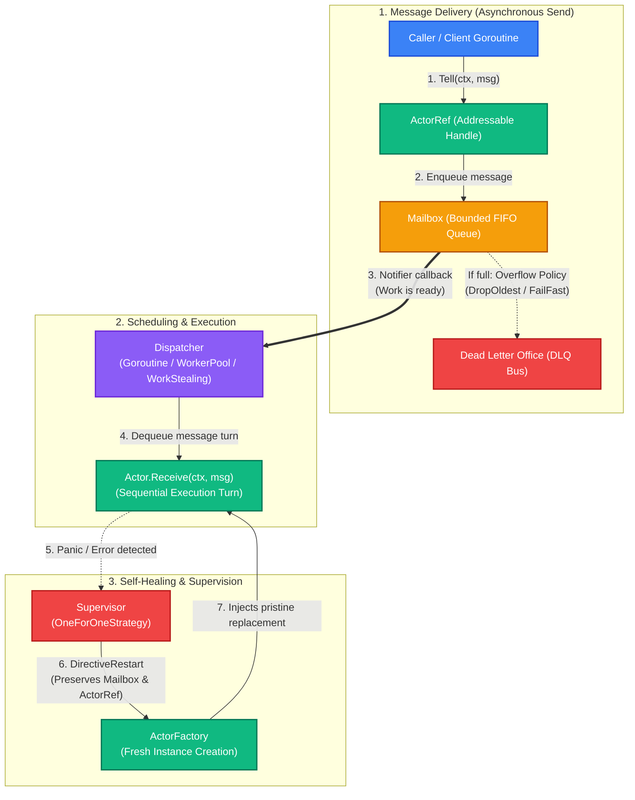

# Chaab Architecture: Message Flow & Lifecycle

This file contains the complete, educational message flow diagram for **Chaab**.
You can copy this into [Mermaid Live Editor](https://mermaid.live) or paste it directly into Excalidraw (via `Insert > Mermaid`).

---

---

## Step-by-Step Flow Explanation (For your Excalidraw Canvas)

### Step 1: Delivery (`Caller` ➔ `ActorRef` ➔ `Mailbox`)
- The caller **never** accesses the actor's state directly.
- The caller only holds an `ActorRef` and calls `ref.Tell(ctx, msg)`.
- The message is pushed into the actor's private, thread-safe `Mailbox`.
- If the mailbox buffer is saturated, the configured `OverflowStrategy` takes effect:
  - `OverflowBlock`: Waits for available space.
  - `OverflowFailFast` / `OverflowDropOldest` / `OverflowDropNewest`: Emits dropped messages to the **Dead Letter Office**.

### Step 2: Scheduling (`Mailbox` ➔ `Dispatcher` ➔ `Actor`)
- When a message lands in an empty mailbox, it signals the configured **Dispatcher** via a notifier callback.
- The Dispatcher (`GoroutineDispatcher`, `WorkerPoolDispatcher`, or `WorkStealingDispatcher`) schedules a turn on a worker thread.
- The worker executes `Actor.Receive(ctx, msg)`. Only **one goroutine** executes an actor at any given moment, guaranteeing **zero race conditions** without locks around business logic.

### Step 3: Self-Healing (`Actor` ➔ `Supervisor` ➔ `Factory`)
- If `Actor.Receive()` panics or fails, the dispatcher intercepts the crash.
- The failure is evaluated by the **Supervisor** (`OneForOneStrategy`).
- If restarts are within limits:
  1. The existing `Mailbox` is **kept open** (queued messages survive).
  2. The `ActorRef` address **remains identical** (callers don't need new handles).
  3. The poisoned in-flight message is **dropped** (prevents infinite crash loops).
  4. The `ActorFactory` constructs a **clean, replacement actor instance** to continue draining the mailbox.
