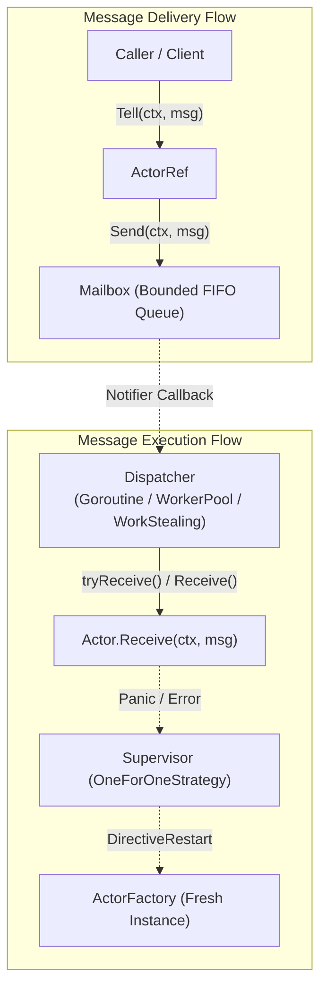

# Chaab

Chaab is a lightweight, domain-agnostic, fault-tolerant **Actor Model Framework** written in Go.

It provides location transparency, strict sequential processing guarantees per actor, non-blocking asynchronous message passing, pluggable execution dispatchers, and self-healing supervision trees inspired by Erlang/OTP and Akka.

---

## Architecture Overview

Chaab decouples **Message Delivery** from **Message Execution**:



1. **Message Delivery**: The caller interacts only with an addressable `ActorRef`. Messages are enqueued into a thread-safe, bounded `Mailbox`. Callers never touch actor state or goroutines directly.
2. **Message Execution**: The configured `Dispatcher` schedules work turns, drains messages sequentially from the mailbox, and invokes the actor's `Receive` method.
3. **Supervision & Recovery**: If an actor panics or fails, the failure is intercepted and routed to the configured `Supervisor`, which decides whether to restart with clean state or terminate.

---

## Core API & Nomenclature Reference

### 1. Actor System Lifecycle

| Method | What It Does (Under the Hood) |
| :--- | :--- |
| `NewSystem(opts ...SystemOption)` | Initializes a new `System` with default configuration (uses `GoroutineDispatcher` by default). |
| `NewSystemWithDispatcher(d)` | Initializes a `System` configured with a specific dispatcher (`WorkerPoolDispatcher` or `WorkStealingDispatcher`). |
| `sys.Shutdown(ctx)` | Initiates graceful shutdown across all actors and the dispatcher. Rejects new actor registrations, closes all mailboxes, waits for buffered messages to drain or `ctx` to expire, and clears the registry. |

---

### 2. Actor Lifecycle: Creation & Spawning

| Method | What It Does (Under the Hood) |
| :--- | :--- |
| `sys.CreateActor(actor, opts...)` | **Convenience creation for stateless or test actors.** Wraps the provided `Actor` instance in a static factory and delegates to `CreateActorFromFactory`. |
| `sys.CreateActorFromFactory(factory, opts...)` | **Recommended production creation.**<br>1. Executes `factory()` to construct the initial actor instance.<br>2. Generates a unique monotonic ID (`actor-1`, `actor-2`).<br>3. Allocates a bounded `Mailbox` (capacity 100).<br>4. Constructs an addressable `ActorRef`.<br>5. Bundles them into an `ActorCell`, retaining the factory for supervised restarts.<br>6. Registers the cell with the `Dispatcher` to begin scheduling.<br>7. Stores the cell in `System.actors` registry and returns the `ActorRef`. |
| `sys.GetActor(id)` | Performs a thread-safe lookup in the registry. Returns `(*ActorRef, true)` if active, or `(nil, false)` if missing or stopped. |

---

### 3. Actor Lifecycle: Stopping & Teardown

| Method | What It Does (Under the Hood) |
| :--- | :--- |
| `sys.Stop(id)` | **Gracefully stops and evicts an actor.**<br>1. Looks up the actor in `System.actors`.<br>2. Closes the actor's `Mailbox` (future `Tell` calls immediately return `ErrActorStopped`).<br>3. **Waits for all currently buffered messages to finish processing** (graceful draining).<br>4. Terminates the actor's worker goroutine or task execution in the dispatcher.<br>5. Evicts the actor from the `System.actors` registry map. |
| `sys.StopActor(id)` | Explicit semantic alias for `sys.Stop(id)`. |
| `sys.Unregister(id)` | Legacy alias for `sys.Stop(id)`. Kept for backward compatibility. |

---

### 4. Messaging (`ActorRef`)

| Method | What It Does (Under the Hood) |
| :--- | :--- |
| `ref.ID()` | Returns the actor's unique identifier string (e.g., `actor-1`). |
| `ref.Tell(ctx, message)` | **Asynchronously enqueues a message.**<br>- Validates inputs (`ErrNilContext`, `ErrInvalidMessage`).<br>- If the actor is stopped, returns `ErrActorStopped`.<br>- Pushes message to mailbox channel.<br>- If mailbox is full, blocks until space becomes available or `ctx` is cancelled.<br>- Notifies the dispatcher that new work is ready. |

---

### 5. Supervision & Fault Tolerance

Chaab implements Akka/OTP-style supervision semantics:

```go
type Directive int

const (
    DirectiveStop Directive = iota  // Permanently stop the actor and close mailbox
    DirectiveRestart                // Discard crashed state, instantiate fresh actor via factory
    DirectiveResume                 // Ignore error, retain current state, process next message
    DirectiveEscalate               // Escalate failure to parent supervisor
)
```

#### `OneForOneStrategy`
Configures bounded restart intensity per actor:

```go
strategy := actor.NewOneForOneStrategy(
    maxRestarts,      // e.g. 3 restarts
    withinDuration,   // e.g. 5 * time.Second
    deciderFunc,      // optional custom Decider mapping Failure -> Directive
)
```

#### Restart Invariants:
1. **Mailbox Preservation**: The mailbox is **never closed** during a restart. It survives and keeps buffered messages intact.
2. **Stable Identity**: The caller's `ActorRef` remains valid; external callers do not need a replacement reference.
3. **Poison Pill Elimination**: The failed in-flight message is **never retried**, preventing infinite crash loops.
4. **Clean State Reset**: The poisoned actor instance is discarded; `cell.Factory()` is invoked to build a pristine replacement.
5. **FIFO Ordering**: New messages sent during restart continue buffering; once the replacement is ready, queued messages drain sequentially in FIFO order.
6. **Bounded Intensity**: If restarts exceed `maxRestarts` within `withinDuration`, the directive switches to `DirectiveStop`.

---

## Execution Dispatchers

Chaab includes three interchangeable execution dispatchers implementing the common `Dispatcher` interface:

1. **`GoroutineDispatcher`**:
   - Spawns one dedicated, persistent goroutine per registered actor.
   - Classic Erlang model; best for long-lived, I/O-heavy actors.
2. **`WorkerPoolDispatcher`**:
   - Fixed pool of $N$ worker goroutines (defaults to `runtime.NumCPU()`).
   - Shared ready queue with `sync.Cond` wakeups.
   - Cooperative scheduling: yields worker thread after `MessageBudget` turns (default 100) to prevent actor starvation.
3. **`WorkStealingDispatcher`**:
   - Decentralized worker-local queues with round-robin task assignment.
   - Idle workers steal tasks from the tail of busy workers' queues (owner pops FIFO from head; thieves steal LIFO from tail).
   - High throughput and low lock contention on multi-core CPU-bound workloads.

---

## Quickstart Example

```go
package main

import (
	"context"
	"fmt"
	"time"

	"github.com/dexisback/chaab/actor"
)

// Define an Actor
type CounterActor struct {
	count int
}

func (c *CounterActor) Receive(ctx context.Context, message any) error {
	switch msg := message.(type) {
	case int:
		c.count += msg
		fmt.Printf("Counter is now: %d\n", c.count)
	case string:
		if msg == "crash" {
			panic("simulated fatal error!")
		}
	}
	return nil
}

func main() {
	// 1. Create System with a WorkerPool Dispatcher
	dispatcher := actor.NewWorkerPoolDispatcher(actor.WorkerPoolConfig{Workers: 4})
	sys := actor.NewSystemWithDispatcher(dispatcher)
	defer sys.Shutdown(context.Background())

	// 2. Define a Supervision Strategy (Restart up to 3 times in 10s)
	strategy := actor.NewOneForOneStrategy(3, 10*time.Second, nil)

	// 3. Spawn Actor using an ActorFactory
	ref, err := sys.CreateActorFromFactory(func() (actor.Actor, error) {
		return &CounterActor{}, nil
	}, actor.WithSupervisor(strategy))
	if err != nil {
		panic(err)
	}

	ctx := context.Background()

	// 4. Send messages
	ref.Tell(ctx, 10)
	ref.Tell(ctx, 20)

	// 5. Trigger supervised restart (mailbox stays open, actor state resets)
	ref.Tell(ctx, "crash")
	ref.Tell(ctx, 5) // Processed by fresh replacement actor!

	time.Sleep(100 * time.Millisecond)

	// 6. Graceful Stop
	sys.Stop(ref.ID())
}
```

---

## Verification & Testing

Every dispatcher and system component adheres to strict concurrency invariants and passes the Go race detector:

```bash
# Run full conformance and unit suite
go test -v ./...

# Run race condition detector
go test -count=1 -race ./...
```
