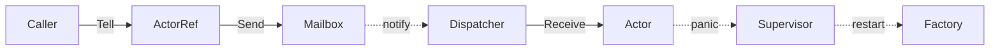

# Chaab

Chaab is a lightweight, domain-agnostic, fault-tolerant **Actor Model Framework** written in Go.

It provides location transparency, strict sequential processing guarantees per actor, non-blocking asynchronous message passing, pluggable execution dispatchers, and self-healing supervision trees inspired by Erlang/OTP and Akka.

---

## Architecture Overview

Chaab decouples **Message Delivery** from **Message Execution**:



1. **Message Delivery**: The caller interacts only with an addressable `ActorRef`. Messages are enqueued into a thread-safe, bounded `Mailbox`. Callers never touch actor state or goroutines directly.
2. **Message Execution**: The configured `Dispatcher` schedules work turns, drains messages sequentially from the mailbox, and invokes the actor's `Receive` method.
3. **Supervision & Recovery**: If an actor panics or fails, the failure is intercepted and routed to the configured `Supervisor`, which decides whether to restart with clean state or terminate.

---

## Core API & Nomenclature Reference

### 1. Actor System Lifecycle

| Method | What It Does (Under the Hood) |
| :--- | :--- |
| `NewSystem(opts ...SystemOption)` | Initializes a new `System` with default configuration (uses `GoroutineDispatcher` by default). |
| `NewSystemWithDispatcher(d)` | Initializes a `System` configured with a specific dispatcher (`WorkerPoolDispatcher` or `WorkStealingDispatcher`). |
| `sys.Shutdown(ctx)` | Initiates graceful shutdown across all actors and the dispatcher. Rejects new actor registrations, closes all mailboxes, waits for buffered messages to drain or `ctx` to expire, and clears the registry. |

---

### 2. Actor Lifecycle: Creation & Spawning

| Method | What It Does (Under the Hood) |
| :--- | :--- |
| `sys.CreateActor(actor, opts...)` | **Convenience creation for stateless or test actors.** Wraps the provided `Actor` instance in a static factory and delegates to `CreateActorFromFactory`. |
| `sys.CreateActorFromFactory(factory, opts...)` | **Recommended production creation.**<br>1. Executes `factory()` to construct the initial actor instance.<br>2. Evaluates configuration options (`WithSupervisor`, `WithMailboxCapacity`, `WithOverflowStrategy`).<br>3. Generates a unique monotonic ID (`actor-1`, `actor-2`).<br>4. Allocates a `Mailbox` with configured capacity and overflow strategy.<br>5. Constructs an addressable `ActorRef`.<br>6. Bundles them into an `ActorCell`, retaining the factory for supervised restarts.<br>7. Registers the cell with the `Dispatcher` to begin scheduling.<br>8. Stores the cell in `System.actors` registry and returns the `ActorRef`. |
| `sys.GetActor(id)` | Performs a thread-safe lookup in the registry. Returns `(*ActorRef, true)` if active, or `(nil, false)` if missing or stopped. |

#### Actor Configuration Options

```go
// Configure supervision policy
actor.WithSupervisor(supervisor)

// Configure custom mailbox buffer capacity (defaults to 100)
actor.WithMailboxCapacity(capacity)

// Configure backpressure / overflow strategy
actor.WithOverflowStrategy(strategy)
```

---

### 3. Mailbox Backpressure & Overflow Strategies

Chaab provides four distinct load-shedding and backpressure strategies to handle mailbox saturation:

```go
type OverflowStrategy int

const (
    // OverflowBlock waits until buffer space opens up or ctx expires (default).
    OverflowBlock OverflowStrategy = iota

    // OverflowFailFast immediately returns ErrMailboxFull without blocking (0ms caller latency).
    OverflowFailFast

    // OverflowDropOldest evicts the oldest message in the mailbox to make room for the new message (Ring Buffer).
    OverflowDropOldest

    // OverflowDropNewest silently discards the incoming message without blocking or failing the caller.
    OverflowDropNewest
)
```

| Strategy | Caller Latency | Data Dropped? | Primary Use Case |
| :--- | :---: | :---: | :--- |
| **`OverflowBlock`** | Can be high (waits for space) | **Never** | Database writers, batch processing, default safe fallback. |
| **`OverflowFailFast`** | $\sim 0\text{ms}$ (instant return) | **Never** (returns `ErrMailboxFull`) | User-facing HTTP APIs, payment webhooks. |
| **`OverflowDropOldest`** | $\sim 0\text{ms}$ (evicts & inserts) | **Yes** (oldest stale items) | Live market feeds, IoT sensors, GPS trackers. |
| **`OverflowDropNewest`** | $\sim 0\text{ms}$ (discards incoming) | **Yes** (newest burst items) | High-volume analytics, load shedding during traffic spikes. |

---

### 4. Actor Lifecycle: Stopping & Teardown

| Method | What It Does (Under the Hood) |
| :--- | :--- |
| `sys.Stop(id)` | **Gracefully stops and evicts an actor.**<br>1. Looks up the actor in `System.actors`.<br>2. Closes the actor's `Mailbox` (future `Tell` calls immediately return `ErrActorStopped`).<br>3. **Waits for all currently buffered messages to finish processing** (graceful draining).<br>4. Terminates the actor's worker goroutine or task execution in the dispatcher.<br>5. Executes `PostStop(ctx)` on the actor if implemented.<br>6. Evicts the actor from the `System.actors` registry map. |
| `sys.StopActor(id)` | Explicit semantic alias for `sys.Stop(id)`. |
| `sys.Unregister(id)` | Legacy alias for `sys.Stop(id)`. Kept for backward compatibility. |

---

### 5. Actor Lifecycle Hooks (`PreStart` & `PostStop`)

Actors can optionally implement lifecycle hooks to allocate and clean up resources (database pools, tickers, network sockets):

```go
type PreStarter interface {
    PreStart(ctx context.Context) error
}

type PostStopper interface {
    PostStop(ctx context.Context) error
}
```

* **`PreStart(ctx)`**: Called once when the actor is created (before receiving its first message) and again on any fresh replacement instance during a supervised restart. If initial `PreStart` fails, `CreateActor` returns an error and aborts registration.
* **`PostStop(ctx)`**: Called when the actor terminates (via `sys.Stop()`, `sys.Shutdown()`, or after exceeding restart limits) and called on the crashed instance prior to replacement during a supervised restart.

---

### 6. Messaging (`ActorRef`)

| Method | What It Does (Under the Hood) |
| :--- | :--- |
| `ref.ID()` | Returns the actor's unique identifier string (e.g., `actor-1`). |
| `ref.Tell(ctx, message)` | **Asynchronously enqueues a message.**<br>- Validates inputs (`ErrNilContext`, `ErrInvalidMessage`).<br>- If the actor is stopped, publishes a `DeadLetter` and returns `ErrActorStopped`.<br>- Pushes message to mailbox channel.<br>- If mailbox overflows, applies the configured `OverflowStrategy` (and publishes a `DeadLetter` if rejected or evicted).<br>- Notifies the dispatcher that new work is ready. |

---

### 7. Dead Letter Office (`DeadLetters`)

Undeliverable, rejected, or evicted messages are never silently dropped; they are wrapped into a `DeadLetter` and published to the system-wide Dead Letter event bus.

```go
type DeadLetter struct {
    RecipientID string
    Message     Message
    Reason      error
    Timestamp   time.Time
}
```

#### Subscribing to Dead Letters

```go
// Subscribe to dead letters (returns an unsubscribe function)
unsubscribe := sys.SubscribeDeadLetters(func(letter actor.DeadLetter) {
    log.Printf("DEAD LETTER: recipient=%s msg=%v reason=%v",
        letter.RecipientID, letter.Message, letter.Reason)
    
    // Emit Prometheus metric or trigger PagerDuty alert
    deadLettersTotal.WithLabelValues(letter.RecipientID).Inc()
})

// Cleanly detach when done
defer unsubscribe()
```

#### Where Dead Letters Are Emitted
1. **Stopped Actor Delivery**: Messages sent via `ref.Tell` to an actor that was stopped with `sys.Stop(id)`.
2. **`OverflowFailFast`**: Messages rejected when mailbox capacity is full.
3. **`OverflowDropOldest`**: Stale messages evicted from the front of the mailbox ring buffer.
4. **`OverflowDropNewest`**: Incoming messages discarded under peak load.

---

### 8. Supervision & Fault Tolerance

Chaab implements Akka/OTP-style supervision semantics:

```go
type Directive int

const (
    DirectiveStop Directive = iota  // Permanently stop the actor and close mailbox
    DirectiveRestart                // Discard crashed state, instantiate fresh actor via factory
    DirectiveResume                 // Ignore error, retain current state, process next message
    DirectiveEscalate               // Escalate failure to parent supervisor
)
```

#### `OneForOneStrategy`
Configures bounded restart intensity per actor:

```go
strategy := actor.NewOneForOneStrategy(
    maxRestarts,      // e.g. 3 restarts
    withinDuration,   // e.g. 5 * time.Second
    deciderFunc,      // optional custom Decider mapping Failure -> Directive
)
```

#### Restart Invariants:
1. **Mailbox Preservation**: The mailbox is **never closed** during a restart. It survives and keeps buffered messages intact.
2. **Stable Identity**: The caller's `ActorRef` remains valid; external callers do not need a replacement reference.
3. **Poison Pill Elimination**: The failed in-flight message is **never retried**, preventing infinite crash loops.
4. **Clean State Reset**: The poisoned actor instance is discarded; `cell.Factory()` is invoked to build a pristine replacement.
5. **FIFO Ordering**: New messages sent during restart continue buffering; once the replacement is ready, queued messages drain sequentially in FIFO order.
6. **Bounded Intensity**: If restarts exceed `maxRestarts` within `withinDuration`, the directive switches to `DirectiveStop`.

---

### 9. Observability, Metrics & Telemetry

Chaab provides a zero-dependency telemetry interface that decouples internal runtime events from third-party metrics providers (Prometheus, OpenTelemetry, Datadog):

```go
type MetricsCollector interface {
    // MessageProcessed records execution duration and completion error for each message.
    MessageProcessed(actorID string, duration time.Duration, err error)

    // ActorRestarted records when an actor fails and is restarted by supervision.
    ActorRestarted(actorID string)

    // TaskStolen records when an idle worker steals a task from another worker's queue.
    TaskStolen(thiefWorkerID int, victimWorkerID int)

    // DeadLetterPublished records when a message is dropped, rejected, or undeliverable.
    DeadLetterPublished(letter DeadLetter)
}
```

#### Runtime Telemetry Hooks:

1. **`DefaultMetricsCollector`**: An atomic, lock-free in-memory collector enabled by default in `NewSystem()`.
2. **`sys.Stats()`**: Returns a thread-safe point-in-time snapshot:
   ```go
   stats := sys.Stats()
   fmt.Printf("Active Actors:     %d\n", stats.ActiveActors)
   fmt.Printf("Total Processed:   %d\n", stats.TotalProcessed)
   fmt.Printf("Total Restarts:    %d\n", stats.TotalRestarts)
   fmt.Printf("Total Task Steals: %d\n", stats.TotalTaskSteals)
   fmt.Printf("Total DeadLetters: %d\n", stats.TotalDeadLetters)
   ```
3. **`ref.MailboxDepth()`**: Returns the instantaneous number of queued messages waiting in an actor's mailbox (essential for monitoring queueing delay and detecting lagging actors).
4. **Custom Integrations**: Pass custom metric collectors via `actor.WithMetrics(customCollector)`.


---

## Execution Dispatchers

Chaab includes three interchangeable execution dispatchers implementing the common `Dispatcher` interface:

1. **`GoroutineDispatcher`**:
   - Spawns one dedicated, persistent goroutine per registered actor.
   - Classic Erlang model; best for long-lived, I/O-heavy actors.
2. **`WorkerPoolDispatcher`**:
   - Fixed pool of $N$ worker goroutines (defaults to `runtime.NumCPU()`).
   - Shared ready queue with `sync.Cond` wakeups.
   - Cooperative scheduling: yields worker thread after `MessageBudget` turns (default 100) to prevent actor starvation.
3. **`WorkStealingDispatcher`**:
   - Decentralized worker-local queues with round-robin task assignment.
   - Idle workers steal tasks from the tail of busy workers' queues (owner pops FIFO from head; thieves steal LIFO from tail).
   - High throughput and low lock contention on multi-core CPU-bound workloads.

---

## Quickstart Example

```go
package main

import (
	"context"
	"fmt"
	"time"

	"github.com/dexisback/chaab/actor"
)

// Define an Actor
type CounterActor struct {
	count int
}

func (c *CounterActor) Receive(ctx context.Context, message any) error {
	switch msg := message.(type) {
	case int:
		c.count += msg
		fmt.Printf("Counter is now: %d\n", c.count)
	case string:
		if msg == "crash" {
			panic("simulated fatal error!")
		}
	}
	return nil
}

func main() {
	// 1. Create System with a WorkerPool Dispatcher
	dispatcher := actor.NewWorkerPoolDispatcher(actor.WorkerPoolConfig{Workers: 4})
	sys := actor.NewSystemWithDispatcher(dispatcher)
	defer sys.Shutdown(context.Background())

	// 2. Define a Supervision Strategy (Restart up to 3 times in 10s)
	strategy := actor.NewOneForOneStrategy(3, 10*time.Second, nil)

	// 3. Spawn Actor using an ActorFactory
	ref, err := sys.CreateActorFromFactory(func() (actor.Actor, error) {
		return &CounterActor{}, nil
	}, actor.WithSupervisor(strategy))
	if err != nil {
		panic(err)
	}

	ctx := context.Background()

	// 4. Send messages
	ref.Tell(ctx, 10)
	ref.Tell(ctx, 20)

	// 5. Trigger supervised restart (mailbox stays open, actor state resets)
	ref.Tell(ctx, "crash")
	ref.Tell(ctx, 5) // Processed by fresh replacement actor!

	time.Sleep(100 * time.Millisecond)

	// 6. Graceful Stop
	sys.Stop(ref.ID())
}
```

---

## Example Application: Banking Simulator

A complete reference implementation demonstrating all core capabilities of Chaab is provided in [`examples/banking`](examples/banking) with a runnable CLI in [`cmd/bank-sim`](cmd/bank-sim).

### Capabilities Demonstrated:
- **Asynchronous Messaging**: Inter-account transfers (`Transfer`, `Deposit`, `Withdraw`) with zero lock contention across actors.
- **Actor Lifecycle Hooks**: `AccountActor` implements `PreStart(ctx)` and `PostStop(ctx)` to manage resource lifecycles.
- **Fault-Tolerant Supervision**: Bounded `OneForOneStrategy` intercepts unhandled panics, safely recreates pristine actor state via `ActorFactory`, and preserves the existing mailbox and `ActorRef`.
- **Backpressure & Load-Shedding**: Bounded mailbox capacity (`WithMailboxCapacity(1)`) paired with `OverflowFailFast` to shed load during bursts.
- **Dead Letter Office**: Captures rejected, evicted, or undeliverable messages via `SubscribeDeadLetters`.
- **Telemetry & Queue Inspection**: Instantaneous queue depth monitoring via `ref.MailboxDepth()` and runtime telemetry snapshots via `sys.Stats()`.

### Running the Simulator:
```bash
go run ./cmd/bank-sim
```

**Sample Output:**
```text
2026/11/14 02:19:52 ERROR actor panicked while processing a message actor_id=actor-2 panic="simulated account crash: simulated unhandled panic"
--- Bank Simulation Completed Successfully ---
Alice Final Balance: $800 (Expected: $800)
Bob Final Balance:   $550 (Expected: $550 after restart)
Total Messages:      7
Total Restarts:      1
Dead Letters:        2
```

---

## Verification, Testing & Benchmarking

### 1. Concurrency & Race Detector Suite
Every dispatcher and runtime component adheres to strict concurrency invariants and passes the Go race detector:

```bash
# Run full unit and integration suite across all packages
go test -v ./...

# Run race condition detector
go test -count=1 -race ./...
```

### 2. Performance Benchmarking
Chaab includes a comprehensive benchmark suite under [`benchmarks/`](benchmarks/) measuring raw dispatch throughput, sub-microsecond round-trip latency, high fan-out actor allocation, and work-stealing efficiency:

```bash
# Measure message throughput (ns/op, B/op, allocs/op across all 3 dispatchers)
go test -bench=BenchmarkThroughput -benchmem ./benchmarks

# Measure round-trip ping-pong latency (reports p50, p95, p99 percentiles)
go test -bench=BenchmarkPingPong -benchmem ./benchmarks

# Measure massive actor concurrency (5,000 actors fan-out)
go test -bench=BenchmarkFanOut -benchmem ./benchmarks

# Measure work-stealing speedup under skewed CPU workload
go test -bench=BenchmarkWorkStealingSkewed -benchmem ./benchmarks

# Run the complete benchmark suite
go test -bench=. -benchmem ./benchmarks
```

---

## Design Decisions & Scope Deferrals

To maintain a lean, high-performance, and domain-agnostic core runtime, Chaab intentionally defers certain higher-level patterns:

1. **Explicit `Tell` over Synchronous `Ask`**:
   - `ref.Ask(ctx, msg, timeout) (any, error)` is deliberately omitted.
   - *Why*: Synchronous request-reply patterns often encourage developers to treat actors like blocking RPC servers, leading to thread exhaustion and cascading timeout failures. Chaab promotes non-blocking asynchronous message passing (`ref.Tell`) with explicit response channels.
2. **Direct Addressing over Actor Routers**:
   - High-level actor routers (e.g., `RoundRobinPool` or `BroadcastPool` forwarding to groups of duplicate worker actors) are omitted from the core runtime.
   - *Why*: The execution runtime already implements round-robin scheduling and work-stealing across worker threads internally. Higher-level load-balancing facades over multiple actor references remain an application-level responsibility rather than runtime complexity.


